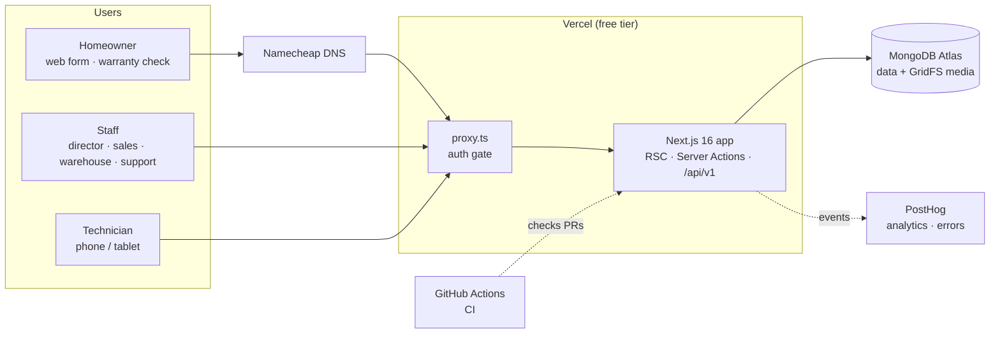
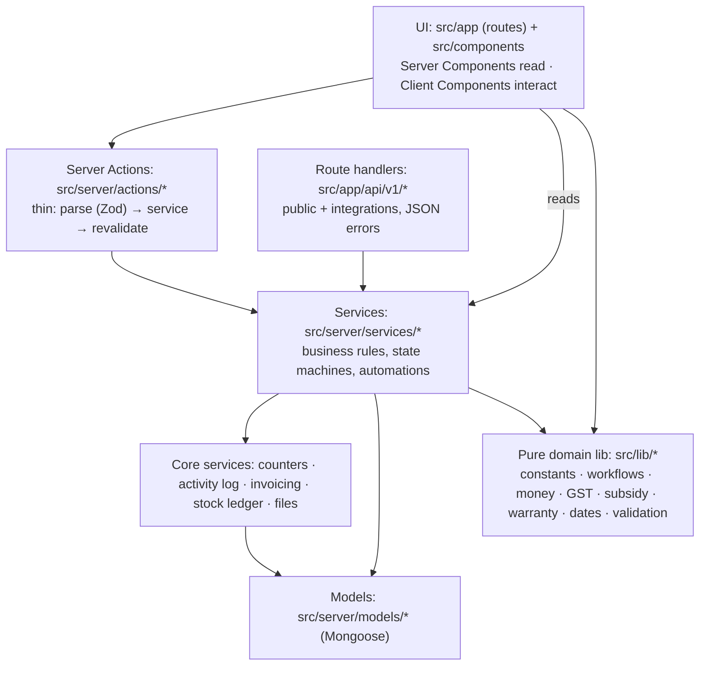
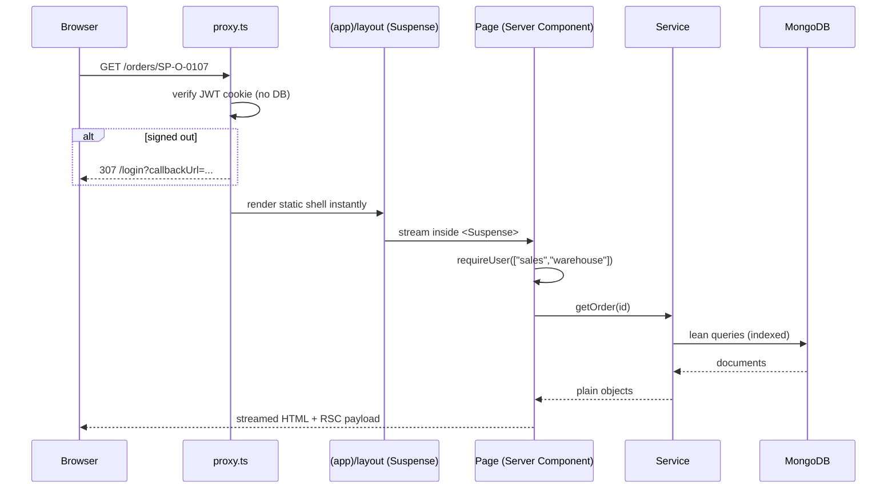
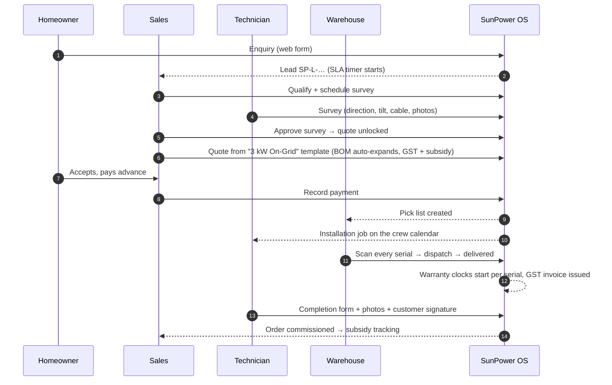
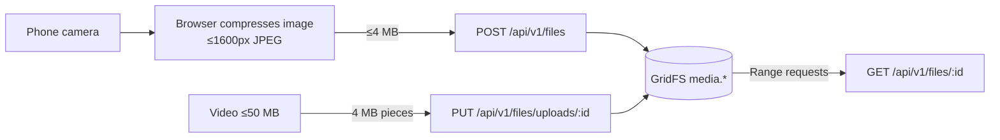
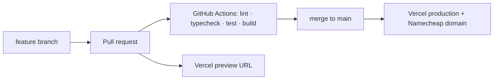

# Architecture.md: System design, data flow and technical architecture

## 1. System context

One **monolith repository** holds the frontend and backend. That keeps one deployable unit and one type system, and lets two developers move fast without contract drift between services.

## 2. Layers inside the app

- **Services never know about HTTP or React.** The seed script, tests, Server Actions and API routes all reuse them.
- **The pure lib is shared by client and server.** The same Zod schema validates a form in the browser and on the server, and the same GST code computes the live quote preview and the stored invoice.
- **The Data Access Layer** (`src/server/auth/session.ts`): every page and action begins with `requireUser(roles)` / `runAction(roles)`, so authorisation can't be forgotten.

## 3. Request lifecycle (staff page)

**Cache Components** (`cacheComponents: true`) makes the shell (sidebar, header, skeletons) prerender and appear instantly. Session- and DB-dependent content streams in behind `<Suspense>`. **Partial Prefetching** prefetches one reusable shell per route, which makes navigation feel instant.

**Rendering rule:** every route folder under `src/app/(app)` has its own `loading.tsx`. With Partial Prefetching, a page that reads the session needs a Suspense boundary *below* the shared app layout for client navigations to be instant. Without one, the Next.js dev validation reports "uncached data … outside of <Suspense>". We hit this on the module placeholders and fixed it with route-level boundaries.

## 4. The lifecycle as one connected flow (golden path)

Automations run as **service-level side effects inside one MongoDB transaction**, so a crash can never leave an order confirmed without its pick list or job.

| Trigger | Automatic effects |
|---|---|
| First payment on an order | status confirmed, pick list, installation job (least-loaded 3-person crew), activity, analytics |
| All pick lines scanned | status ready_to_dispatch |
| Delivery | serials → installed, warranty start/end per serial, GST sale invoice, activity |
| Job completed (installation) | order commissioned, labour hours logged for costing and payroll |
| Ticket resolved out of warranty | service invoice for parts + labour, stock issued |
| Customer confirms the fix | ticket closed |

## 5. Gates (process enforcement)

| Gate | Where enforced |
|---|---|
| No quote before survey approval | quote service + locked UI on the lead |
| No dispatch until every serialized unit is scanned and every line is picked | dispatch service |
| No installation start before materials are delivered | job service |
| No ticket closure without customer confirmation | ticket state machine |
| Every status change must be legal | `assertTransition(entity, FLOW, from, to)` |

## 6. Security model

- **Authentication:** Auth.js v5 Credentials provider. Passwords are bcrypt hashes. The session is a signed + encrypted JWT in an httpOnly cookie that expires after 12 h.
- **Authorisation:** roles (`admin`, `sales`, `technician`, `warehouse`, `support`) are checked in three places: `proxy.ts` (signed-in only), pages via `requireUser(roles)`, and every mutation via `runAction(roles)`. Admin may do everything.
- **Input validation:** Zod on every action and endpoint, plus HTML constraints in forms.
- **Abuse protection** on public endpoints: rate limits and a honeypot field.
- **Privacy:** the public warranty lookup masks names and never returns phones or addresses. Analytics events never contain customer PII.
- **Secrets:** only in environment variables (`.env.local` locally, Vercel project settings in production).

## 7. Media pipeline

Vercel caps request bodies at 4.5 MB, so large files are split into 16 × 255 KiB pieces that map 1:1 onto GridFS chunks. No extra storage vendor is needed.

## 8. Observability

- **PostHog:** product analytics (event taxonomy in `product/Analytics.md`). Business events are captured server-side in `after()` so they never slow a request, plus browser pageviews and exception autocapture.
- **`/api/v1/health`** for uptime checks. Vercel runtime logs record unexpected errors (`[action]` / `[api]` prefixes).

## 9. Delivery pipeline

Production runs at **https://www.sunpowersolutions.me** (Namecheap DNS → Vercel; the apex redirects to `www`), with **https://sunpowersolutions.vercel.app** as the Vercel URL.

**Region:** Vercel functions run in **Mumbai (`bom1`)**, pinned in `vercel.json`, next to users in India and the Atlas cluster in Asia. They were in Washington DC (`iad1`, the default) until 31 Oct, when every request crossed India → US → Atlas (about 1.8 s of cold database latency). `/api/v1/health` reports the live `region`.

## 10. Scalability and evolution
- Stateless app servers on Vercel scale horizontally. Mongoose connections are cached per instance to respect Atlas limits.
- Indexes cover every list filter (status + date, technician + schedule, serial, phone).
- Clear seams for growth: swap GridFS for object storage, add a queue for notifications (email/WhatsApp Business API), and add more DISCOM/state rules in `src/lib/subsidy.ts`.
