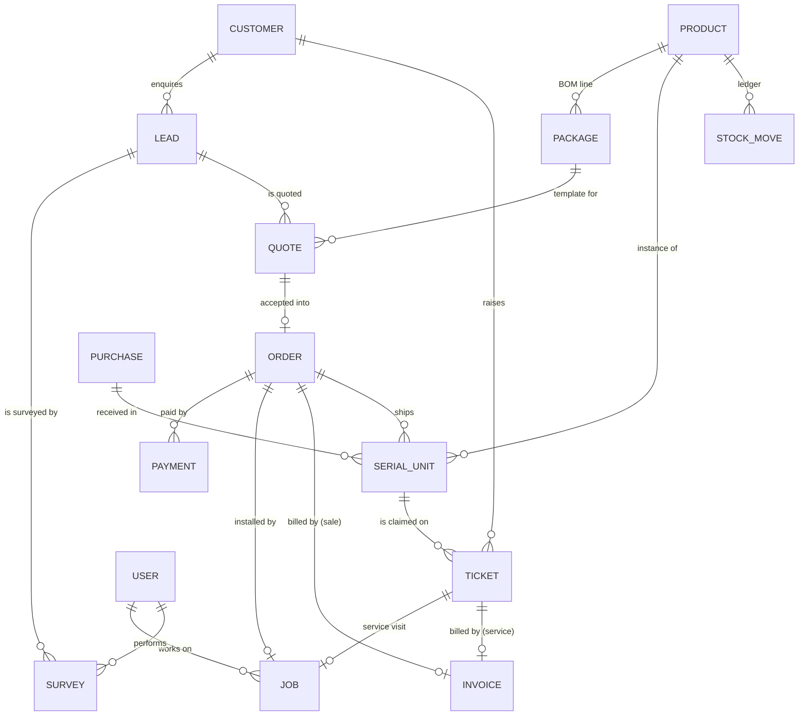

# DB.md: Data model, constraints and conventions

MongoDB (Atlas M0 in production, an in-memory replica set for local development), accessed through **Mongoose 9**.
Schemas live in `src/server/models/*` and are imported from one place: `import { Lead, Order } from "@/server/models"`.

## Conventions

| Rule | Why |
|---|---|
| **Money is stored as integer paise** (`*Paise` fields, ₹1 = 100) | No floating-point drift in GST totals. Converted only at the edges (`src/lib/money.ts`) |
| **Human-readable numbers** from atomic counters: `SP-L-0001` (lead), `SP-SV` (survey), `SP-Q` (quote), `SP-O` (order), `SP-PAY` (payment), `SP-J` (job), `SP-T` (ticket), `SP-GRN` (goods receipt), `INV/26-27/0001` (GST invoice per financial year) | Customers and staff read numbers aloud on calls. Counters can't collide (`findOneAndUpdate $inc`, upsert) |
| **Snapshots on documents**: quote/order line items copy name, SKU, price, cost, GST, HSN and warranty | Later catalog edits never rewrite historical quotes or invoices |
| **Denormalised actor refs** `{ id, name }` (createdBy, recordedBy, …) | Timelines and printed documents render without joins |
| **Statuses are enums with state machines** (`src/lib/workflows.ts`) | Illegal transitions are rejected in services (`assertTransition`) |
| **Multi-document writes run in transactions** (`withTransaction`) | e.g. "payment → confirm order → pick list → installation job" is all-or-nothing |
| **Every change writes an Activity** | Audit trail and the per-record / per-customer timelines |
| `timestamps: true` on all collections | `createdAt` / `updatedAt` for SLAs, aging and reports |

## Entity relationships

## Collections

### users
| Field | Type | Constraints |
|---|---|---|
| name, phone | string | required |
| email | string | **unique**, lowercase |
| role | enum `admin, sales, technician, warehouse, support` | required, indexed |
| passwordHash | string (bcrypt, cost 10) | required, `select: false` (never returned by default) |
| hourlyRatePaise | int | ≥ 0. Prices technician time for job costing and payroll |
| skills | string[] | e.g. `survey`, `installation`, `service` |
| active | bool | inactive users cannot sign in |

### customers
| Field | Type | Constraints |
|---|---|---|
| name | string | required, indexed |
| phone | string | **unique**, `^[6-9]\d{9}$` (10-digit Indian mobile). Primary lookup key for support |
| email, gstin, notes | string | optional |
| type | enum `residential, commercial` | default residential (drives subsidy eligibility) |
| address | `{ line1, line2?, city, district?, state=Telangana, pincode ^[1-9]\d{5}$ }` | required |
| discom | enum `TSSPDCL, TSNPDCL` | optional |
| consumerNumber | string | electricity service number (net metering, subsidy) |

### leads
`number` (**unique**), `customerId` → customers (indexed), denormalised `name / phone (indexed) / email / city`, `source` enum (`website, whatsapp, phone, walk_in, referral, other`), `requirement { capacityKw 1–10, systemType on_grid|off_grid|unsure, wantsSubsidy, monthlyBillRs?, message? }`, `qualification { roofAreaSqft, shadowFreeAreaSqft, monthlyBillRs, sanctionedLoadKw?, gridSuitable, roofType, notes?, qualifiedAt, qualifiedBy }`, `status` (LEAD_FLOW, indexed), `lostReason`, `assignedTo` → users, `firstContactedAt` (response-time SLA), `lastActivityAt`, `surveyId`, `quoteId`, `orderId`.
Index: `{ status: 1, createdAt: -1 }`.

### surveys
`number` (unique), `leadId`, `customerId`, `technicianId` (indexed), `scheduledFor`, `status` (`scheduled → completed → approved | rejected`), `measurements { roofDirection N…NW, tiltDeg 0–60, roofType, usableAreaSqft, shadingPct 0–100, cableDistanceM, floors, earthingPossible, recommendedKw 1–10, recommendedSystemType }`, `photos` (GridFS ids), review fields (`reviewedBy`, `reviewedAt`, `reviewNote`).
Index: `{ technicianId: 1, scheduledFor: 1 }`.

### products
`sku` (**unique**, uppercase), `name`, `brand`, `category` (panel, inverter, battery, charge_controller, structure, acdb, dcdb, cable, connector, earthing, lightning_arrestor, meter, accessory, service), `unit` (nos, m, set, kit, job, kw), `isSerialized` (panels, inverters, batteries and charge controllers are scanned at dispatch), `specs` (free-form), `costPaise`, `pricePaise`, `gstRate` 0–28, `hsn` (HSN/SAC), `warrantyMonths`, `stockQty`, `reorderLevel`, `active`.

### packages
`code` (**unique**, e.g. `ONG-3`, `OFG-5`), `name`, `systemType`, `capacityKw` 1–10, `description`, `lines [{ productId, qty }]` (the bill-of-materials template), `active`.

### quotes
`number` (unique), `version`, `leadId`, `customerId`, `packageId`, `packageCode`, `title`, `systemType`, `capacityKw`, `lines` (LineItem snapshots), `taxablePaise`, `gstPaise`, `totalPaise`, `subsidyPaise` (PM Surya Ghar estimate), `netCostPaise`, `status` (`draft → sent → accepted | rejected | expired`), `validUntil`, `sentAt`, `acceptedAt`, `createdBy`.

### orders (the post-sale project)
| Field | Notes |
|---|---|
| `number` unique, `quoteId` **unique** (one order per accepted quote), `leadId`, `customerId` | |
| `title`, `systemType`, `capacityKw`, `siteAddress`, `lines` | snapshot of the accepted quote |
| `taxablePaise`, `gstPaise`, `totalPaise`, `paidPaise`, `paymentStatus` (unpaid/partial/paid) | |
| `status` | ORDER_FLOW: pending_payment → confirmed → ready_to_dispatch → dispatched → delivered → installing → commissioned → closed (or cancelled) |
| `pickList [{ productId, sku, name, qty, isSerialized, serials[], picked }]` | built automatically at confirmation |
| `dispatch { vehicleNo, driverName, driverPhone, dispatchedAt/By, deliveredAt/By, deliveryNote }` | |
| `installationJobId`, `invoiceId` | created automatically |
| `subsidy { applicable, status, applicationNo, expectedPaise, disbursedPaise, history[] }` | PM Surya Ghar tracker |
| `extraCosts [{ label, kind, amountPaise, at }]` | costs that reduce the job's profit: `kind: site` (extra material or work on the roof, from job completion) or `warranty` (a free repair absorbed later, from a resolved ticket) |
Indexes: `{ status: 1, createdAt: -1 }`, `{ "subsidy.status": 1 }`.

### payments
`number` (unique), `customerId`, `orderId?`, `invoiceId?`, `ticketId?`, `amountPaise` ≥ 1, `mode` (upi, bank_transfer, cash, cheque, card), `type` (advance, balance, full, service), `reference` (UTR/UPI/cheque no), `receivedAt` (indexed), `recordedBy`.

### serialunits
`serial` (**unique**, uppercase), `productId`, `sku`, `productName`, `category`, `status` (in_stock → allocated → dispatched → installed → faulty/replaced/returned), `purchaseId`, `costPaise`, `orderId`, `customerId`, lifecycle dates, **`warrantyStartAt` / `warrantyEndAt`** (set automatically at delivery = deliveredAt + warrantyMonths), `replacedBySerial` / `replacesSerial`, `history[]`.
Indexes: `{ productId: 1, status: 1 }`, `warrantyEndAt`, `orderId`, `customerId`.

### stockmoves (append-only ledger)
`productId`, `sku`, signed `qty`, `type` (purchase, dispatch, return, adjustment, service_issue), `serials[]`, `refType` / `refId` / `refNumber`, `note`, `by`, `at`.
Invariant: `products.stockQty` = sum of the ledger. For serialized products it also equals the count of `in_stock + allocated` serial units.

### purchases (goods receipts)
`number` (unique), `supplier { name, gstin, phone }`, `invoiceNo`, `invoiceDate`, `lines [{ productId, sku, name, qty, unitCostPaise, serials[] }]`, `totalPaise`, `receivedAt`, `receivedBy`.

### jobs (installations and service visits)
`number` (unique), `type` (installation | service), `orderId?`, `ticketId?`, `customerId`, `title`, `siteAddress`, `scheduledFor` (indexed), `estimatedHours`, `technicianIds[]` (indexed), `leadTechnicianId`, `status` (scheduled → in_progress → completed | cancelled), `startedAt`, `finishedAt`, `confirmedKw`, `kwChangeReason` (required when it differs from the order), `generationReadingKw`, `kitCheck { complete, missing? }`, `checklist { mounting, panels, wiring, earthing, inverter, testing }`, `photos[]` (GridFS ids), `signature { dataUrl (PNG), signedBy, signedAt }`, `timeLogs [{ technicianId, technicianName, hours 0–24, date }]` (labour cost and payroll), `materialsUsed [{ productId, sku, name, unit, qty, costPaise }]` (extra material on site; also posted to stock and to the order's `extraCosts`).

### tickets
`number` (unique), `customerId`, `orderId`, `serial` (indexed), `serialUnitId`, `productName`, `category` (no_power, fault_code, low_generation, physical_damage, battery, wiring_earthing, structure, billing, other), `faultCode`, `description`, `priority` (low/medium/high/urgent → SLA 72/48/24/4 h), `channel`, `status` (TICKET_FLOW: open → assigned → in_progress → resolved → **customer_confirmed** → closed; "Not fixed" returns resolved, confirmed or closed tickets to in_progress), **`warranty { state: in_warranty | out_of_warranty | no_serial, basis: serial | workmanship | none, endsAt, checkedAt }`** (decided at creation, BR-04), `billable` (= not in warranty, unless overridden), `billingOverride { billable, reason, by, at }`, `assignedTo`, `jobId` (the service visit), `resolution { type, notes, partsUsed[], labourHours, labourRatePaise, replacementSerial, resolvedAt, resolvedBy }`, `customerConfirmedAt`, `confirmation { confirmedBy, channel: call | whatsapp | on_site, note, recordedBy, at }`, `serviceCostPaise` (in-warranty cost charged to the order), `reopenCount`, `invoiceId` (out-of-warranty service invoice), `slaDueAt`, `closedAt`.

### invoices (GST tax invoices)
`number` (unique, `INV/<FY>/<seq>`), `type` (sale | service), `customerId`, `orderId?`, `ticketId?`, `billTo { name, phone, address, gstin? }`, `lines [{ description, hsn, qty, unitPricePaise, gstRate, taxablePaise, gstPaise, totalPaise }]`, `taxablePaise`, `gstPaise`, `cgstPaise`, `sgstPaise`, `igstPaise` (intra-state Telangana → CGST + SGST), `totalPaise`, `paidPaise`, `status` (issued, partially_paid, paid, void), `issuedAt` (indexed), `dueAt`.

### sharelinks
`token` (**unique**, 24 random bytes, base64url), `scope` (dashboard), `label`, `createdBy`, `expiresAt` (1–30 days), `revokedAt`, `viewCount`, `lastViewedAt`. Checked on every view, so revocation is immediate.

### counters
`_id` = counter key (`SP-L`, `INV/26-27`, …), `seq`.

### activities (audit log)
`entityType`, `entityId`, `customerId?` (indexed, for Customer 360), `action` (machine verb), `message` (human sentence), `actorId`, `actorName`, `meta`, `createdAt`.
Index: `{ entityType: 1, entityId: 1, createdAt: -1 }`.

### media.files / media.chunks (GridFS) + media_uploads
Photos, short videos and survey media. Files are stored in 255 KiB chunks. Browsers upload pieces of ~4 MB each (under Vercel's 4.5 MB request limit) that are assembled into standard GridFS documents. `media_uploads` tracks in-progress chunked uploads. Limits: images ≤ 10 MB (compressed client-side to ~1600 px), videos ≤ 50 MB.

## Behaviour notes (implemented)

- **Lead dedupe:** an enquiry from a phone that already has an open lead (not won/lost) created in the last 30 days is attached to that lead as an activity, never duplicated.
- **Auto-assignment:** website leads go to the active salesperson with the fewest open leads; leads entered by a salesperson stay with them.
- **Customer DISCOM:** set from the city on creation (TSNPDCL for north Telangana: Warangal, Karimnagar, Nizamabad, Khammam…; TSSPDCL otherwise).
- **Survey photos:** a submission is rejected unless every photo id exists in `media.files`, so half-uploaded files never land on record.
- **Quotes:** lines snapshot product name, SKU, cost, GST, HSN and warranty at save. The server re-reads products (only quantity and unit price come from the client) and recomputes totals with `src/lib/quote-calc.ts`.
- **Acceptance:** creates the order (`pending_payment`) with a subsidy tracker (`not_applied` when eligible), wins the lead, and marks the lead's other open quotes `rejected` ("Superseded by …"). Expired quotes cannot be accepted.
- **First payment:** confirms the order, builds `pickList` from every non-service line, and creates the installation job at 09:30 IST about four days out with three installers who have **no other job that day** (least loaded first; Sundays skipped; if fewer than three are free it moves to the next day that has them — `services/core/crew.ts`).
- **Cancellation:** only before dispatch and before any payment; releases allocated serials and cancels the scheduled job.
- **Goods receipt:** one unique serial per serialized unit; each unit is created `in_stock` with **its own GRN cost**, and every line posts a `purchase` stock move.
- **Packing:** a scan allocates the unit to the order (wrong product, a unit packed for another order, or one not in stock is refused with a message naming the problem). When every serial is scanned and every bulk line ticked the order moves to `ready_to_dispatch`; an un-scan moves it back.
- **Dispatch:** re-checks the pick list inside the transaction (`DISPATCH_INCOMPLETE`), posts `dispatch` stock moves, and **issues the GST sale invoice** with payments so far applied (BR-18). Later order payments also update that invoice.
- **Delivery:** every serial's `warrantyStartAt` = delivery, `warrantyEndAt` = + the warranty months sold on the order line.
- **Installation:** starts only after delivery; completion (BR-14) marks serials `installed`, commissions the order, writes one time log per crew member from the recorded start/finish, and posts extra material as stock moves and `extraCosts` (`site`).
- **Tickets:** in warranty → ₹0, and parts at cost + labour at the technician's rate go to the order's `extraCosts` (`warranty`); out of warranty → a `service` invoice for parts (sell price) + labour (₹600/h) + GST. A replacement unit must be the same product and in stock; it inherits the remaining cover when free, or gets a fresh term when paid (BR-15). Close only from `customer_confirmed`.
- **Costing (`services/costing.ts`):** revenue excl. GST − material (serial GRN costs, excluding replacement units; bulk at the order's cost snapshot; quote estimate before dispatch) − labour (installation time logs × rate) − site extras − warranty repairs.

## Demo data in Atlas (seeded 31 Oct)

`npm run seed -- --yes` writes, idempotently: 20 staff accounts · 30 products · 10 packages · 5 goods receipts (181 serials + consumables) · **121 finished installations over 14 months** plus three older ones from the brief's scenes (18, 25 and 28 months: Venkata Ramana Rao, Lakshmi Prasanna, Padmavathi Devi) with 1,103 serials, 17 monthly GRNs, sale invoices, 225 payments, crew time logs, subsidy files at every stage, 3 loss-making jobs with their causes and 2 warranty replacements · **today's pipeline** through the services: 11 leads at every stage (two past the call-back SLA), 8 orders from awaiting payment to installing, 6 service tickets. History and pipeline run once each (`seed:history` / `seed:pipeline` counters).

## Capacity notes
- Expected volume: about 40 orders/month → about 500 orders, 6,000 serial units and 1,000 tickets per year. That is a small fraction of Atlas M0's 512 MB, except for media. Images are compressed before upload and videos are capped to protect storage.
- Upgrade path: Atlas M10+ (more storage and backups) or moving media to object storage without touching the API (only `services/core/files.ts` changes).
