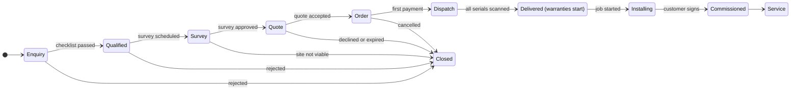

# SunPower: Product Requirements Document

| | |
|---|---|
| **Product** | SunPower |
| **Customer** | SunPower Solutions, a rooftop solar installer in Telangana, India |
| **Event** | Odoo x GCET Hackathon 2026, Team 19 |
| **Version** | 1.0, 31 Oct 2026 |
| **Owners** | Hanvith Sai Alla (product, architecture, frontend) · Lagishetty Vamshi (backend, database, integration, tests) |
| **Status** | P0 approved for build; P1 and P2 if time allows |
| **Related** | [Plan.md](../Plan.md) · [Features.md](Features.md) · [User_Persona.md](User_Persona.md) · [Analytics.md](Analytics.md) · [Style_Guide.md](Style_Guide.md) · [Requirements.md](Requirements.md) |

## 1. Summary

SunPower is one web platform that takes a SunPower customer from the first enquiry to the end of the 20-year panel warranty. Each customer is a single project record that moves through one lifecycle (section 7). Leads, surveys, quotes, stock, dispatch, installation, service and invoicing are views of that record, in the same order as an integrated ERP (CRM → Sales → Inventory → Field Service → Helpdesk → Invoicing). The system enforces the gates people forget today: no quote before an approved survey, no dispatch until every serial is scanned, and no closed complaint until the customer confirms the fix.

## 2. Problem

### 2.1 Context

SunPower completes about 40 rooftop projects a month for homes and small factories. It sells ready-made systems from 1 kW to 5 kW in two kinds, On-Grid (grid-connected) and Off-Grid (with battery backup), plus a hardware-only solar panel set and installation as a service. It runs roof surveys, holds high-value stock (panels, inverters, batteries) and sends a crew of 15 technicians to sites. A steady stream of service calls follows every installation.

### 2.2 How things run today

| Area | Today | Effect |
|---|---|---|
| Enquiries | Arrive on WhatsApp, calls and a web form | Leads are lost or called back late |
| Quotes | Typed by hand each time | Parts are missed, crews make second trips, margin leaks |
| Serial numbers | Written on paper | Lost by the time a warranty claim arrives |
| Site work | Site registers; photos on personal phones | No proof of work; disputes with customers |
| Money | Notebooks and phones | No view of revenue, margin per job or unfinished work |

**Root cause:** no single record follows the customer from stage to stage. Every hand-off (sales to technician, technician to warehouse, warehouse to crew, crew to support, everyone to the director) loses information, so the owner loses money, customers get frustrated and technicians are overwhelmed.

## 3. Goals and non-goals

### 3.1 Goals

| # | Goal | Evidence in the product |
|---|---|---|
| G1 | No enquiry is lost, and every lead gets a fast first call | Every channel lands in one pipeline; SLA badge after 2 h |
| G2 | Every quote is complete, correctly priced and follows an approved survey | Template bills of materials (BOMs); GST and subsidy maths; server-side survey gate |
| G3 | Every serialized unit is traceable from goods receipt to customer | Serial register; dispatch blocked until every serial is scanned |
| G4 | Warranties start by themselves and support answers warranty questions in seconds | Warranties created at delivery; search under 1 s |
| G5 | Every installation has proof | Times, confirmed kW, photos and the customer's signature on every job |
| G6 | The director sees profit per job and unfinished work for today, this week and this month | Costed orders; dashboard; shareable read-only link |

### 3.2 Non-goals (explicit scope cuts)

| Not in this release | What we do instead |
|---|---|
| Payment gateway | Payments recorded by hand (UPI, NEFT, cash, cheque) with a reference number |
| WhatsApp Business API | Free `wa.me` click-to-chat deep links with a prefilled message |
| SMS | None; email notifications are P2 (F21) |
| Native mobile app | Responsive, mobile-first web screens for technicians; offline drafts are P2 (F23) |
| Multi-company or multi-branch | One company, one GSTIN, one warehouse |
| Accounting ledger, GST returns, e-invoice (IRN), e-way bills | Invoices and payments only; CSV export for the accountant |
| PM Surya Ghar portal integration | Subsidy stages tracked by hand in F16 |
| Customer accounts | Public warranty lookup (F20) and a tracking link (F22), no login |
| Languages other than English | English UI; Telugu and Hindi later |

## 4. Users

Five internal roles and one public user. Full personas are in [User_Persona.md](User_Persona.md).

| Role (code) | Persona | Main job in SunPower | Home screen |
|---|---|---|---|
| Director (`admin`) | Rajesh Reddy | Money and progress; team, catalog and settings | `/dashboard` |
| Sales (`sales`) | Priya Sharma | Leads, qualification, survey review, quotes, orders, payments | `/leads` |
| Technician (`technician`) | Ravi Kumar (+14) | Surveys, installations and service visits on a phone | `/my-work` |
| Warehouse (`warehouse`) | Suresh Yadav | Goods receipt, stock, pick lists, serial scanning, dispatch | `/dispatch` |
| Support (`support`) | Anjali Rao | Search, warranty checks, tickets until the customer confirms | `/service` |
| Homeowner (public, no login) | Lakshmi Narayana | Enquiry form, warranty lookup, project link | `/` |

## 5. Success metrics

The north-star metric is **installations commissioned per month** (baseline about 40). Definitions, sources and the event plan are in [Analytics.md](Analytics.md).

| Metric | Today | Target |
|---|---|---|
| Installations commissioned per month (north star) | ~40 | 48 within 6 months, same 15 technicians |
| Enquiries captured in the pipeline | Unknown, some lost | 100% |
| Lead first-response time (median) | Not tracked | ≤ 30 min; 95% within 2 h |
| Survey completed → quote sent (median) | Days | ≤ 24 h |
| Quote acceptance rate | Not tracked | ≥ 50% |
| Lead → order conversion | Not tracked | ≥ 20% |
| Dispatch accuracy (kit complete on arrival) | Parts often missed | 100% |
| Order confirmed → commissioned (median) | Not tracked | ≤ 7 days |
| Support lookup of customer, serial and warranty | Minutes, sometimes never | Search under 1 s |
| Month-end review | Days of collecting notebooks | Minutes; shareable link |

Demo success: the golden path in [Plan.md §9](../Plan.md) runs end to end on the production URL in under 5 minutes, on seeded data, with no errors.

## 6. Scope by scene

| Scene from the brief | Pain | Features | What the demo shows |
|---|---|---|---|
| 1. The rooftop inquiry | Enquiries vanish; calls and surveys go unrecorded; quotes sent before surveys | F03, F04, F05, F06 (F21) | A phone enquiry lands in the pipeline with a red "uncontacted" badge; survey approval unlocks the quote |
| 2. Getting the kit right | Hand-typed quotes miss parts; warehouse and crew told by phone | F07, F08, F09 (F16) | "3 kW On-Grid" fills every BOM line with GST and subsidy; the first payment creates the pick list and the job |
| 3. Dispatch day and serial numbers | Serials on paper; wrong unit to the wrong customer | F10, F11 | A wrong or missing serial blocks dispatch; delivery starts every warranty |
| 4. On the roof | Site registers, scattered photos, no proof | F12 (F18, F23) | Mobile job form with times, kW, photos and an on-screen signature; installation certificate |
| 5. The rainy season breakdown | Customer and serial can't be found; warranty unknown; complaints forgotten | F13, F14 (F20) | ⌘K finds a serial in under 1 s; ₹0 in-warranty ticket; automatic out-of-warranty invoice; close only after the customer confirms |
| 6. The director's month-end | No P&L; invoices, subsidy and technician pay scattered | F14, F15 (F16, F17, F18) | Profit per job with losers in red; open repairs; stuck projects; share link |
| All scenes (platform) | No single record, no access control | F01, F02 (F19, F22) | Role-based sign-in; one shell and search; timeline on every record |

Features in brackets are P1 or P2.

## 7. Lifecycle state machine

Every project moves through one state machine. Services reject illegal transitions with typed errors, and the UI shows them as plain-language toasts.

| # | Transition | Trigger (actor) | Guard (must be true) | Automation |
|---|---|---|---|---|
| T1 | → Enquiry | Public form or manual entry (sales) | Valid name, mobile, address, pincode and source | Lead number; first-response clock starts; a repeat mobile joins the open lead |
| T2 | Enquiry → Qualified | Sales completes the checklist | Roof area, monthly bill, grid suitability and DISCOM recorded | Prompt to schedule a survey |
| T3 | Qualified → Survey | Sales schedules the survey | Active technician and date set | Survey appears in the technician's My work |
| T4 | Survey → Quote | Sales or admin approves the survey | Survey submitted with measurements and photos | "Create quote" unlocks (BR-01) |
| T5 | Quote → Order | Customer accepts; sales records it | Quote version is Sent and still valid | Order created from that version; other versions superseded |
| T6 | Order → Dispatch | First payment recorded (sales) | BR-08 payment rules | Order confirmed; pick list and installation job created in one transaction (BR-07) |
| T7 | Dispatch → Delivered | Warehouse dispatches, then marks delivered | Every serialized line fully scanned and valid (BR-02) | Serials dispatched; stock reduced; one warranty per serial from the delivery date (BR-03) |
| T8 | Delivered → Installing | Technician taps Start | Job scheduled; order delivered | Start time logged |
| T9 | Installing → Commissioned | Technician completes the job | BR-14 proof complete | Serials installed; certificate; time logs; job costing updated |
| T10 | Commissioned → Service | Automatic | None | After-sales phase for the life of the warranties; tickets open and close inside it |
| T11 | Enquiry to Order → Closed | Sales rejects, customer declines, quote expires, admin cancels | Reason required; cancellation only before dispatch | Lead marked Rejected or Lost; stock reservations released |

The lead pipeline (F04) is the sales view of the early stages: New and Contacted are Enquiry, then Qualified, Survey, Quoted (Quote) and Won (Order onwards); Rejected and Lost are Closed. Tickets can be raised from Delivered onwards, because a unit can fail before commissioning.

## 8. Business rules and gates

| ID | Rule | Enforced by |
|---|---|---|
| BR-01 | **Survey gate.** A quote can be created or sent only when the lead's latest survey is Approved. | Disabled button with the reason; server error `SURVEY_NOT_APPROVED` |
| BR-02 | **Dispatch gate.** Dispatch is blocked until every serialized pick-list line has exactly its quantity of valid scans (serial exists, In stock, right product, not on another order) and every bulk line is ticked. | Disabled button; server re-check inside the dispatch transaction (`DISPATCH_INCOMPLETE`) |
| BR-03 | **Warranty at delivery.** Marking an order Delivered creates one warranty per serial: start = delivery date (IST), end = start + the product's warranty months. Defaults: inverter 24, battery 24, charge controller 24, panels 240. Months are copied at delivery, so later catalog edits never change issued warranties. Nobody types warranty dates. | Delivery service |
| BR-04 | **Warranty state.** In warranty when the ticket date is on or before the end date (shown as Expiring soon in the last 60 days); otherwise Out of warranty. A ticket on a serial uses that serial's warranty. A ticket with no serial (wiring, earthing, structure, leaks) uses the **workmanship warranty**: the installation service's warranty months (default 60) from the commissioning date. Only customers with no SunPower installation are Not applicable. | Computed, never typed |
| BR-05 | **Billing.** In warranty: parts and labour cost the customer ₹0, and their cost (parts at cost price, labour at the technician's hourly rate) is **charged to the original order's costing**. Out of warranty: resolving the ticket creates a service invoice for parts (sell price) + labour (hours × rate) + GST. Admin or support can override billability with a mandatory reason (for example physical damage), logged on the timeline. | Ticket service |
| BR-06 | **Ticket closure.** A ticket closes only from Customer confirmed, which records who confirmed, how (call, WhatsApp, on site) and when. "Not fixed" returns it to In progress. | Ticket state machine |
| BR-07 | **Order confirmation.** The first payment (advance or full) confirms the order and, in one transaction, creates the pick list and the installation job. All three happen or none do. The job's crew is chosen from installers with no other job that day (least loaded first); if fewer than 3 are free, the job moves to the next day that has 3. | MongoDB transaction |
| BR-08 | **Payments.** Amount > 0 and ≤ balance due; date not in the future; reference (UTR or cheque number) required except for cash. Payments are never deleted; admin reverses one with a reason. | Zod schema + service |
| BR-09 | **Quote versions.** Sent quotes are read-only; edits create a new version. Accepting a version supersedes the others and locks its prices into the order. Prices are snapshots, so catalog changes never alter existing quotes. Quotes expire after 15 days (configurable). | Quote service |
| BR-10 | **Leads never vanish.** Leads can't be deleted, only closed as Rejected or Lost with a reason. An enquiry from a mobile number that already has an open lead is added to that lead as an activity. | Lead service |
| BR-11 | **First-response target (SLA).** A New lead not yet contacted shows an amber badge after 1 h and a red one after 2 h; red leads sort first. | Pipeline query |
| BR-12 | **Serial integrity.** A serial is unique per product, sits on at most one open order, and moves only In stock → Dispatched → Installed → Replaced or RMA. | Unique index + service |
| BR-13 | **Stock.** On-hand stock never goes negative. Stock enters only through a goods received note (GRN) or a return, and leaves only through dispatch or an admin adjustment with a reason. | Stock service |
| BR-14 | **Installation proof.** A job starts only after the order is Delivered, and completes only with a finish time after the start, confirmed kW (with a reason if it differs from the order), the generation test ticked, the kit check answered, at least one photo and the customer's signature. | Job service |
| BR-15 | **Replacement warranty.** A unit replaced under warranty inherits the remaining term of the unit it replaces; a paid replacement starts a fresh term from the replacement date. | Ticket service (to confirm, Q3) |
| BR-16 | **Money.** Stored as integer paise. GST is computed per line and rounded half-up to the paisa; totals are sums of rounded lines; amounts are shown in ₹ with Indian grouping. | Shared money helpers |
| BR-17 | **Audit.** Every state change, payment, scan and override is written to the record's timeline with actor, role and time. | Activity log (F19) |
| BR-18 | **Sale invoice at dispatch.** Dispatching an order issues its GST tax invoice in the same transaction, with payments received so far applied. Under GST a goods invoice is due at or before removal of goods (CA to confirm, Requirements Q10). | Dispatch service |

## 9. India specifics

### 9.1 Formats and identifiers

| Item | Rule | Example |
|---|---|---|
| Currency | ₹ with lakh and crore grouping; whole rupees in lists, paise on invoices; compact form on KPI cards | ₹1,50,000 · ₹12,34,567.50 · ₹18.6 L · ₹1.2 Cr |
| Dates and times | DD MMM YYYY, 12-hour clock, Asia/Kolkata (IST) everywhere, including on the UTC server | 31 Oct 2026, 10:30 AM |
| Financial year | April to March; invoice numbers restart each FY | FY 2026-27 |
| Mobile | +91 and 10 digits starting with 6–9 | +91 98480 12345 |
| Pincode | 6 digits; Telangana pincodes start with 50 | 500072 (Kukatpally) |
| GSTIN | 15 characters; Telangana state code 36 | 36ABCDE1234F1Z5 (format only) |
| Capacity | kW for systems, Wp for panels | 3 kW system, 6 × 545 Wp |

### 9.2 GST

Rates follow the GST 2.0 reform (effective 22 Sep 2025), which cut solar equipment from 12% to 5%. Rates are stored per product and editable; the values below are seeded defaults that SunPower's chartered accountant (CA) must confirm (Q1).

| Line type | Example HSN/SAC | GST | Intra-state split (Telangana) |
|---|---|---|---|
| Solar equipment: PV modules, inverters, charge controllers, ACDB/DCDB, structures, cables, connectors, earthing, lightning arrestors | 8541, 8504, 8537, 7308, 8544, 8536 | 5% | CGST 2.5% + SGST 2.5% |
| Batteries | 8507 | 18% | CGST 9% + SGST 9% |
| Installation service | SAC to be confirmed by the CA | 18% | CGST 9% + SGST 9% |

All customers are in Telangana, so every sale is intra-state (place of supply: Telangana, state code 36) and splits into CGST and SGST. Inter-state supply (IGST) is out of scope for this release.

### 9.3 PM Surya Ghar: Muft Bijli Yojana subsidy

- **Eligibility in SunPower:** residential customer and On-Grid system only. Off-Grid systems and business customers get no subsidy line.
- **Amount** (central financial assistance at general-category rates, which apply to Telangana): ₹30,000 per kW for the first 2 kW, ₹18,000 for the 3rd kW, capped at ₹78,000.
- **Formula:** `subsidy = 30000 × min(kW, 2) + 18000 × min(max(kW − 2, 0), 1)`, calculated on the quote's system capacity.

| Capacity | 1 kW | 2 kW | 3 kW | 4 kW | 5 kW |
|---|---|---|---|---|---|
| Expected subsidy | ₹30,000 | ₹60,000 | ₹78,000 | ₹78,000 | ₹78,000 |

- The government pays the subsidy into the customer's bank account after the DISCOM installs the net meter and inspects the system. SunPower invoices the full price. Quotes show the subsidy as "Expected subsidy" and an "Effective cost after subsidy"; it never reduces SunPower's invoice or revenue. The amount actually released is decided on the national portal and recorded in F16.
- F16 tracks each application: Applied → Feasibility approved → Net meter installed → Inspected → Subsidy disbursed, with dates and documents.

### 9.4 Worked example (illustrative prices)

3 kW On-Grid system for a home in Kukatpally:

| Line | Taxable | GST | CGST | SGST | Total |
|---|---|---|---|---|---|
| Equipment (panels, inverter, balance of system) | ₹1,50,000 | 5% | ₹3,750 | ₹3,750 | ₹1,57,500 |
| Installation service | ₹15,000 | 18% | ₹1,350 | ₹1,350 | ₹17,700 |
| **Quote total, payable to SunPower** | ₹1,65,000 | | ₹5,100 | ₹5,100 | **₹1,75,200** |
| Expected PM Surya Ghar subsidy, paid to the customer | | | | | −₹78,000 |
| **Effective cost after subsidy** | | | | | **₹97,200** |

### 9.5 DISCOMs and net metering

- Two electricity distribution companies (DISCOMs) serve SunPower's area: **TSSPDCL** in the south (Hyderabad, Secunderabad, Rangareddy and nearby) and **TSNPDCL** in the north (Warangal, Karimnagar, Khammam, Nizamabad and nearby). Both now also trade as TGSPDCL and TGNPDCL, so the DISCOM is a configurable value.
- On-Grid systems need a bi-directional net meter installed by the DISCOM; units exported to the grid are credited against the customer's bill. The lead records the DISCOM, the sanctioned load and the service connection number (USC number on the bill); the subsidy tracker records net-meter installation and inspection dates.
- Off-Grid systems don't connect to the grid, need no net meter and get no subsidy.

## 10. User stories and acceptance criteria (P0)

Each acceptance criterion is testable on seeded data. Screens, fields and validations are detailed in [Features.md](Features.md).

### F01 Sign-in and role-based access

*As a staff member, I want to sign in once and see only the work my role allows, so that customer and financial data stay protected.*

1. Valid email and password set an httpOnly, Secure, SameSite=Lax session cookie and open the role's home screen (section 4).
2. Wrong credentials show "Email or password is incorrect" without saying which; 5 failures in 15 minutes lock that email for 15 minutes.
3. A signed-out visit to any staff route redirects to `/login?next=<path>` (enforced in `proxy.ts`).
4. A route or action outside the user's role is refused, and every server action and API route re-checks the role on the server.
5. Deactivated users can't sign in; signing out clears the session.

### F02 App shell and navigation

*As any staff user, I want one consistent workspace with role-aware navigation and global search, so that I never hunt for a screen or a record.*

1. The sidebar shows only the modules of the user's role and highlights the current one; below 1024 px it collapses into a drawer.
2. ⌘K (Ctrl+K on Windows) opens global search from any staff page.
3. Every list and detail view has a loading skeleton, an empty state with the next action, and an error state with Retry.
4. Every mutation shows a toast; business-rule errors read in plain language (for example "Approve the survey before creating a quote").
5. Every staff screen works at 360 px width without horizontal page scrolling.

### F03 Public enquiry form

*As a homeowner, I want to ask for a quote online in under two minutes, so that someone calls me back.*

1. `/enquiry` captures name, mobile, optional email, address, pincode, customer type (home or business), system type (On-Grid, Off-Grid, not sure), capacity (1–5 kW or not sure), monthly bill and subsidy interest, with consent.
2. The same Zod schema validates in the browser and on the server; errors appear inline next to each field.
3. On success the visitor sees a reference number (for example SP-L-0231) and when to expect a call.
4. The lead appears in the New column of `/leads` with source `web`; nobody re-types it.
5. A repeat enquiry from a mobile number with an open lead joins that lead as an activity; more than 5 submissions per IP per hour are refused.

### F04 Lead pipeline

*As a salesperson, I want every lead from every channel in one pipeline with overdue ones flagged, so that nobody waits for a call.*

1. `/leads` offers kanban and table views, filterable by status, source, owner, city and age.
2. Manual entry requires a source: web, WhatsApp, call, walk-in or referral.
3. Uncontacted New leads show an amber badge after 1 h and a red "Uncontacted 2h" badge after 2 h; red leads sort first.
4. Call (`tel:`) and WhatsApp (`wa.me/91…` with a prefilled message) open a quick log; "Reached" moves the lead to Contacted and stops the clock.
5. Status changes follow the state machine only; there is no delete; Rejected and Lost need a reason; every change appears on the lead's timeline.

### F05 Qualification

*As a salesperson, I want a short checklist on the first call, so that technicians only visit roofs that can work.*

1. The checklist records shadow-free roof area (sq ft), roof type, monthly bill (₹), sanctioned load, phase, DISCOM (TSSPDCL or TSNPDCL), service connection number and grid suitability.
2. Qualify stays disabled until every item is filled.
3. The system suggests a capacity from the roof area (about 100 sq ft per kW, up to 5 kW) and warns when the requested kW is higher or exceeds the sanctioned load.
4. Reject requires a reason from a list (shaded roof, too little area, grid not suitable, budget, not interested, outside service area, duplicate).

### F06 Site survey

*As a salesperson I assign a survey, as a technician I fill it in on the roof, and as a salesperson I approve it, so that the quote rests on real measurements.*

1. Scheduling needs an active technician and a date; the survey appears in that technician's `/my-work`.
2. The mobile form captures roof direction (8 compass points), tilt (0–60°), cable distances in metres (panels to inverter, inverter to distribution board), shading, usable area, structure type and at least 2 photos.
3. Submit is blocked until required fields are valid; photos are compressed on the phone to about 200 KB.
4. Sales or admin approves, or rejects with a reason; a rejection asks for a revisit or closes the lead as not viable.
5. Approval unlocks "Create quote" (BR-01).

### F07 Catalog and package templates

*As the director, I want one product list and ready-made packages, so that nobody types a quote or has to remember parts.*

1. Products carry SKU, name, brand, category, unit, serialized flag, cost price, sell price, HSN/SAC, GST rate and warranty months; SKU is unique.
2. Panels, inverters, batteries and charge controllers are serialized and must have warranty months.
3. Packages hold a code, type (panel set, On-Grid, Off-Grid), capacity (1–5 kW) and BOM lines, including the installation service line.
4. The seed has 10 system templates (1–5 kW × On-Grid and Off-Grid) with full BOMs; Off-Grid adds batteries.
5. Products in use can be deactivated but never deleted.

### F08 Quote builder

*As a salesperson, I want to pick a template and get a complete, correctly taxed quote, so that the customer gets an accurate price in minutes.*

1. "Create quote" is disabled, with the reason shown, until the survey is approved; the server refuses otherwise (BR-01).
2. Choosing "3 kW On-Grid" fills every BOM line (about 14) including installation.
3. Lines are editable (quantity, price, add, remove); GST is computed per line and split into CGST and SGST; totals update as you type.
4. Residential On-Grid quotes show the expected subsidy and effective cost (₹78,000 for 3 kW); Off-Grid and business quotes show none.
5. The A4 print view shows company GSTIN, HSN, the tax split and ₹ amounts; a sent quote is read-only, edits create version 2, and quotes expire after 15 days.

### F09 Orders and payments

*As a salesperson, I want to record acceptance and payment once, so that the warehouse and crew start without a phone call.*

1. Accepting a sent quote creates an order (for example SP-O-0099) locked to that version.
2. A payment records type (advance, balance, full), mode (UPI, NEFT, cash, cheque), amount, date and reference; BR-08 applies.
3. The first payment confirms the order and creates the pick list and the installation job in one transaction (BR-07).
4. The order page shows total, paid and balance, with links to its pick list, job, invoices and timeline.

### F10 Inventory, serials and purchases

*As the warehouse in-charge, I want stock and every serialized unit tracked from the moment it arrives, so that I always know what we have and where it went.*

1. `/inventory` lists on-hand, reserved and available quantities and stock value at cost, with a low-stock badge at or below the reorder level.
2. A GRN in `/inventory/purchases` records supplier, supplier invoice number, date and lines; serialized lines need exactly one unique serial per unit (scan, type or paste a list).
3. A duplicate serial is rejected with the existing unit's details.
4. `/inventory/serials` filters by status (In stock, Dispatched, Installed, Replaced, RMA), product, order and customer, and shows each unit's history.

### F11 Dispatch and warranty start

*As the warehouse in-charge, I want to scan every serialized unit before the truck leaves, so that we know which unit went to which customer and warranties start on time.*

1. `/dispatch/[orderId]` shows each line's required and scanned quantity; scanning works with the phone camera (barcode) or by typing.
2. Each scan is checked (exists, In stock, right product, not already scanned, quantity not exceeded) and rejected with a specific message otherwise.
3. Dispatch stays disabled until every serialized line is complete and every bulk line is ticked; the server checks again (BR-02).
4. Marking the order Delivered creates one warranty per serial from the delivery date (BR-03) and confirms it, for example "8 warranties started".

### F12 Installation

*As a technician, I want a simple phone form for each job, so that I record the work and get the homeowner's sign-off on the spot.*

1. `/jobs` shows a crew calendar with a "To schedule" lane; scheduling sets a date and a lead technician (plus helpers), and the job appears in their `/my-work`.
2. Start is available only once the order is Delivered, and records the start time.
3. Complete requires a finish time after the start, confirmed kW (with a reason if it differs from the order), the generation test ticked, the kit check answered, at least one photo and the customer's on-screen signature with their name.
4. Completion marks the serials Installed, moves the order to Commissioned, writes time logs and produces a printable installation certificate (date, kW, serials, photos, signature).
5. Buttons and inputs are at least 44 px tall on phones.

### F13 Service desk, search and warranty

*As a support agent, I want to find the customer and their serial within seconds and track the complaint until they confirm the fix, so that callers get a fair answer and nothing is forgotten.*

1. ⌘K search matches mobile numbers (full or last 4+ digits), names, serials (full or last 4+ characters) and document numbers, groups results by type and responds in under 1 s on seed data.
2. The warranty card shows product, serial, delivery date, end date and state (for example "In warranty · 6 months left").
3. A ticket records customer, serial (optional), category, fault code or description and priority, and moves Open → Assigned → In progress → Resolved → Customer confirmed → Closed.
4. In-warranty tickets cost ₹0; resolving an out-of-warranty ticket creates the service invoice automatically (BR-05).
5. A replacement marks the old serial Replaced (or RMA) and installs the new one on the same project (BR-15); Close is enabled only after the customer confirms (BR-06).

### F14 Invoices and job costing

*As the director or a salesperson, I want GST-correct invoices and a true cost for every job, so that we get paid and know what we earned.*

1. An invoice is issued from an order in one click (prefilled from the accepted quote), or created automatically for an out-of-warranty ticket.
2. It shows SunPower's legal name, address and GSTIN; the customer's name, address and GSTIN (business customers); place of supply (Telangana, 36); HSN/SAC, quantity, rate, taxable value, CGST and SGST per line; totals and the amount in words.
3. Numbers are sequential per financial year and at most 16 characters (for example INV/26-27/0001); issued invoices are read-only.
4. Status moves Issued → Partly paid → Paid, or Overdue after the due date.
5. Each order shows costing: revenue (excl. GST) − material cost (cost price of dispatched units and parts) − labour (hours × hourly rate) − extras = profit and margin %.

### F15 Director dashboard

*As the director, I want today, this week and this month at a glance, so that I know which jobs made money, which lost money and what is unfinished.*

1. A period switch (Today, This week Monday–Sunday, This month; IST) updates every figure.
2. KPI cards: revenue (invoiced, excl. GST), cash collected, new leads, installations commissioned, gross margin and open tickets.
3. A sortable profit-per-job table shows loss-making rows in red and rows below 15% margin in amber.
4. Lists of stuck projects (no stage change for 7 days, with stage and owner) and open repairs (oldest first), a revenue trend chart and subsidy pipeline counts.
5. Every figure comes from live database queries (no static JSON), and the page loads in under 2 s on seed data.

## 11. Non-functional requirements

| Area | Requirement |
|---|---|
| Performance | Staff pages render in under 2 s on the full seed (~150 projects, 14 months); search under 1 s; technician pages usable on a mid-range Android phone on 4G |
| Validation | Zod schemas shared by forms and server; the server never trusts the client; business rules return typed errors |
| Security | bcrypt password hashes; signed JWT session in an httpOnly cookie; role checks in `proxy.ts` and again in every server action and API route; rate limits on public endpoints; expiring, revocable share tokens |
| Privacy | Collect only what the job needs (Digital Personal Data Protection Act 2023); `/privacy` notice with rights and grievance contact; analytics only after opt-in cookie consent; no customer phone or email in analytics; public pages mask personal data |
| Reliability | Automations run inside MongoDB transactions; human-readable numbers come from atomic counters |
| Accessibility | WCAG 2.2 AA target; full keyboard access; 44 px touch targets on technician screens ([Style_Guide.md](Style_Guide.md)) |
| Compatibility | Current Chrome, Edge, Safari and Firefox; Android Chrome for camera scanning |
| Observability | PostHog product analytics, session replay, heatmaps, Core Web Vitals and exception capture (browser parts with consent); Vercel logs |
| Data | Money in integer paise; dates stored in UTC and shown in IST; warranty records kept for at least 20 years |

## 12. Release scope

| Priority | Features | Release rule |
|---|---|---|
| P0 Must (golden path) | F01 Auth and roles · F02 Shell and search · F03 Enquiry form · F04 Pipeline · F05 Qualification · F06 Survey · F07 Catalog · F08 Quotes · F09 Orders and payments · F10 Inventory · F11 Dispatch · F12 Installation · F13 Service · F14 Invoices and costing · F15 Dashboard | Ships in v1.0 (coding ends 01 Nov 2026, 10:00 AM). Never cut. |
| P1 Should | F16 Subsidy tracker · F17 Share link and CSV · F18 Technician hours · F19 Activity timeline · F20 Warranty lookup | Ships if P0 is stable by T+9:30 |
| P2 Could | F21 Email notifications · F22 Project tracking link · F23 Offline job form | Only if ahead of schedule |

## 13. Risks

| Risk | Impact | Mitigation |
|---|---|---|
| 12-hour build window | P0 incomplete | MoSCoW priorities; golden path first; P2 then P1 cut first |
| Camera scanning fails on a device | Dispatch demo blocked | Manual entry always visible; printed barcode labels for the demo serials |
| MongoDB Atlas M0 limits (512 MB, no automated backups) | Full storage or data loss | Photos compressed to ~200 KB; lean seed; export before the demo; idempotent reseed |
| GST or subsidy rules change | Wrong quotes | GST rate per product; subsidy slabs in one config module; CA sign-off |
| Weak network on rooftops | Lost forms | Small payloads and retries; offline drafts (F23) |
| Technicians don't adopt the app | Missing proof and hours | Few fields, large targets, photos and signature only where required |
| Personal data exposure | Legal and trust damage | Role checks, masked public views, no personal data in analytics or URLs |
| Next.js 16 API changes | Broken build | Read the bundled docs (`proxy.ts` replaces `middleware.ts`); CI on every PR |

## 14. Open questions

1. **GST:** line-wise rates (current design) or the 70:30 deemed-value rule for composite solar contracts? Which SAC applies to installation? (CA to confirm.)
2. **Warranty start:** we follow the brief and start at delivery. Does any manufacturer start from invoice or commissioning date instead?
3. **Replacement warranty:** inherit the remaining term (BR-15) or start a fresh term?
4. **Advance:** what minimum advance confirms an order, and must the balance be paid before dispatch?
5. **Service charges:** out-of-warranty labour rate and visit charge; are lightning and physical damage excluded from warranty?
6. **PM Surya Ghar:** is SunPower a registered vendor with TSSPDCL and TSNPDCL? Do all residential packages use DCR (domestic content) panels, which the scheme requires? Who files the application, the customer or SunPower?
7. **On-Grid kit:** the brief lists a battery charge controller in the On-Grid package. Keep it in On-Grid templates?
8. **SLA clock:** 2 hours of wall-clock time, or working hours only?
9. **Compliance:** are e-invoices (IRN) for business customers and e-way bills for dispatches required at SunPower's turnover? Out of scope for v1.0.
10. **Language:** should the quote and installation certificate also be available in Telugu?
